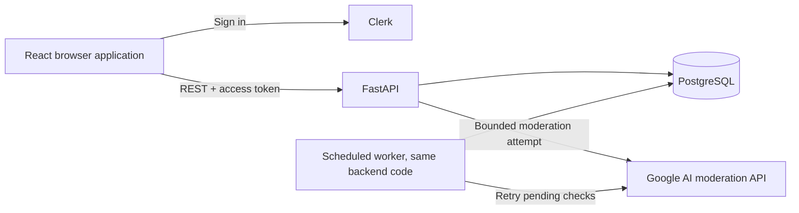

# Rivock product and design decisions

Prepared October 11, 2026; implementation authorized by the user. The code and verification status are recorded in [IMPLEMENTATION.md](IMPLEMENTATION.md). Defaults below are adopted for this build; account eligibility and real external integrations remain unverified.

Rivock is a public, text-first advice and discussion site. The primary users are advice seekers and people browsing conversations. College students are the initial audience, but anyone can participate. The project goal is to understand a complete application from idea through deployment, with a useful résumé demonstration as an outcome.

## What you already chose

| Area | Confirmed decision |
| --- | --- |
| Product | Shared feed and threads; no communities, user karma, or reputation gates |
| Stack | React + TypeScript + Vite; FastAPI REST API; PostgreSQL; SQLAlchemy + Alembic |
| Authentication | Clerk; email/password and Google; selected October 14 after the Entra setup restriction |
| Access | Public reading; account required for posting, replies, votes, saves, and later DMs |
| Content | Questions and discussions; separate threads and replies; one accepted direct answer per question |
| Editor | Basic Markdown, toolbar, preview; raw HTML disabled; no attachments initially |
| Topics | Exactly one preset topic per thread: Education, Relationships, Careers, Money, Health & Wellbeing, Hobbies, Everyday Life |
| Limits | Title 200 characters; thread body 10,000; reply 5,000; required title and body |
| Conversation | Five reply levels; responses beyond level five stay at level five and identify their target |
| Votes | Up/down votes on individual contributions; set, change, or remove one vote per account/contribution |
| Ordering | Trending feed with Latest alternative; votes and freshness only; Recommended replies mix votes and freshness, accepted answer first; nested replies chronological |
| Search | Thread titles and bodies; topic filtering; Relevance or Newest |
| Other launch features | Private saved threads, profiles/history, editing/deleting, blocks, reports, in-app notifications, basic admin controls |
| Moderation | Rules and rate/spam checks plus AI; clear violations rejected; uncertain cases publish/log; AI outages leave submissions pending for retry |
| Delivery | Docker + GitHub Actions; Azure preferred; target $10/month excluding domain |
| Later | DMs, personalized feeds, uploads, and labeled fictional bot activity |

## Remaining decisions, completed with proposed defaults

| Area | Proposed default and reason |
| --- | --- |
| Usernames | Unique, case-insensitive, 3–24 ASCII letters/digits/underscores; fixed after onboarding for a simpler v1 |
| Profiles | Optional moderated 300-character bio and preset avatar; last approved profile stays visible during review; no public email, real-name requirement, or profile score |
| Roles | Member and admin; admin assigned by an explicit operator command, never by email domain |
| Permissions | Backend checks ownership/account status on every write; members cannot set admin or bot flags |
| Sign-in | Clerk-hosted account portal through the React SDK; return to the original screen after onboarding |
| Account linkage | Verified issuer + immutable subject; never automatically merge accounts by matching email |
| API | Versioned `/api/v1`; JSON; 20 items/page, maximum 50; database-backed permission and rate checks |
| Frontend tooling | React Router, TanStack Query, native Fetch, shared CSS/design tokens; preserve the approved demo's visual direction |
| Ranking | For both threads and direct replies, `net_votes / (age_hours + 2)^0.5`; ties newest first; edits do not reset age |
| Voting | No self-votes; block relationships prevent votes on each other's contributions |
| Moderated edits | Last approved version stays visible; pending replacement is private; a stale decision cannot overwrite a newer revision |
| Outages/retries | Durable submission records; bounded inline AI attempt, then worker retries every five minutes; unresolved items go to admin review |
| Notifications | Poll while the app is visible; direct replies notify thread author, nested replies notify addressed author; no own/blocked-user events |
| Deletion | Author deletion removes their text and leaves a structural placeholder; questions lose an accepted answer if that answer is deleted/removed |
| Account departure | Self-service deactivation hides the profile, labels contributions `[deleted]`, clears bookmarks/notifications/bio, and prevents writes; full identity erasure is an operator procedure |
| Operations | One backend codebase with an API process and worker command; no Redis, Celery, Kubernetes, or additional business microservices at launch |
| Hosting | Static Web Apps Free frontend; Container Apps Consumption API + scheduled job; Azure PostgreSQL only if subscription allowances fit the budget |
| Cost fallback | If Azure PostgreSQL is ineligible/too expensive, use a managed external PostgreSQL service after reviewing its current plan; do not silently provision paid Azure database capacity |

These engineering defaults were included in the consolidated implementation scope approved by the user. Numeric rates, ranking constants, retry timing, and budget caps are configuration values.

## How the application fits together

The browser displays screens and requests operations. FastAPI validates input, verifies identity, enforces permissions, runs moderation, and writes records. PostgreSQL enforces relationships and uniqueness. Clerk manages credentials; the Google AI service receives only the text needed for moderation.

## Screens and important behavior

The launch screens are Feed/Search, Thread Detail, Create/Edit Thread, onboarding, public profile, Saved, Notifications, Settings/Blocks, My Submissions, and an admin review page. The approved [clickable demo](../reference/design-demo.html) establishes the light background, readable dark text, blue accents, Inter typography, desktop sidebar, and mobile navigation. Its four sample topics are superseded by the seven confirmed topics above.

Drafts survive sign-in redirects within the browser tab. Publishing either opens the approved thread or shows a pending/rejected submission with a reason and revision controls. Readers never see pending drafts. Nested replies load on demand, and a new reply is highlighted so its author can find it without changing the permanent sort order.

Blocking hides the other person's content in the blocker's signed-in experience and prevents new direct interactions in either direction. It does not make already-public content private. Removed/deleted ancestors remain as placeholders where needed to read other people's replies.

## Moderation and cost controls

Ordinary profanity and disagreement are allowed. Rules target spam, scams, threats, hateful attacks, and targeted harassment rather than rejecting every word on a profanity list. AI decisions use a structured decision and safe reason code, with uncertain results published and logged. Provider errors, malformed results, and unavailable budget remain pending instead of being treated as approval.

Proposed launch caps: five new threads/hour and twenty/day per member; thirty replies/hour and one hundred/day; no duplicate copy-paste submission from the same user within 24 hours. Each check is configurable. Start the AI adapter disabled locally, use deterministic fixtures for tests, and enable a verified model for deployment. Proposed AI ceiling: $2/month within the overall $10 target, plus a 100-call/day hard cap and one concurrent call. Cost metering must be configured from the selected model's real pricing before enabling it.

Azure eligibility, region capacity, domain purchase, identity configuration, and actual model access have not been verified in this account. The Azure deployment runbook has an explicit cost/eligibility check before provisioning. A budget alert alone does not stop spend.

## Delivery order and review criteria

1. Put the reviewed documents and approved demo reference in the dedicated Rivock repository; add application skeletons, local PostgreSQL, migrations, and CI.
2. Connect Clerk onboarding and complete **sign in → publish → view → reply → accept answer**, including moderation states.
3. Add voting/ranking, topics/search, saves, profiles, edit/delete, notifications, blocking/reports, and admin actions in small tested slices.
4. Verify permissions, keyboard/mobile behavior, concurrency, provider outages, and database restore; then deploy within the verified cost plan.
5. Add labeled fictional seed content and later DMs/bot activity as separate milestones after the core site works.

Acceptance means a real second account can find and answer a question, the author can accept that direct answer, and both accounts see consistent persisted state after reload. Invalid credentials, non-owner edits, duplicate votes, cross-thread reply parents, unsafe Markdown, and moderation outages must behave correctly too.

## Supporting implementation documents

- [Product specification and acceptance criteria](SPECIFICATION.md)
- [Architecture, library choices, and data flows](ARCHITECTURE.md)
- [Database entities, constraints, and lifecycle](DATABASE.md)
- [REST contracts and error behavior](API.md)
- [Security and moderation rules](SECURITY.md)
- [Screens, editor, and accessibility](UI_GUIDELINES.md)
- [Local development, Azure deployment, and cost checks](DEPLOYMENT.md)
- [Ordered implementation and verification tasks](TODO.md)
- [Draft instructions for development agents](AGENTS.md)
- [Source references and decision status](REFERENCES.md)
- [Completed implementation, verification and setup handoff](REVIEW.md)
- [Limited moderation evaluation and coverage gaps](MODERATION_EVALUATION.md)
- [Clerk account and local key setup](CLERK_SETUP.md)

This file records the product decisions. Application code is now implemented locally; [implementation status](IMPLEMENTATION.md) records the checks and limits. No repository push, cloud provisioning or public deployment has happened.
